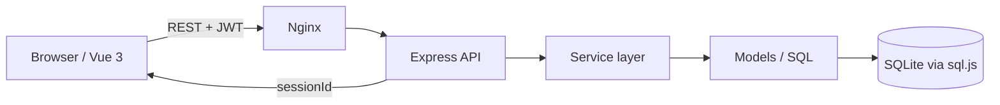

# Quiz App

一个可自托管的刷题与模拟考试系统：Vue 3 前端 + Express 后端 + SQLite（sql.js），支持多用户、随机组卷、服务端判分、错题本、邀请码注册与 DOCX 导出。


## 功能

- **随机组卷**：按题型分段抽取（60 单选 / 10 多选 / 20 判断，满分 100），也可按错题重练或智能组卷（一半错题 + 一半新题）。
- **服务端判分**：正确答案不下发到浏览器；组卷时服务端签发 `sessionId`，交卷按题库答案复核，同一份试卷只能提交一次。
- **错题本**：按试卷分组或按题目平铺查看，记录错误答案、正确答案、复习次数，可筛选、排序、批量标记复习。
- **多用户**：邀请码注册、独立考试记录、管理员可踢下线、封禁设备、删除用户。
- **DOCX 导出**：纯前端生成答卷 + 错题集，含答案对照。
- **零原生依赖**：数据库使用 sql.js（SQLite/WASM），不需要编译 better-sqlite3，Docker 镜像更小、跨平台更省事。
- **移动端可用**：答题卡在桌面端固定侧栏，移动端悬浮展开。

## 技术栈

| 层 | 技术 |
|---|---|
| 前端 | Vue 3、Vite、vue-router、Axios、docx |
| 后端 | Node.js 20+、Express 4、sql.js、JWT、bcryptjs |
| 数据库 | SQLite（文件持久化，WASM 运行） |
| 部署 | Docker、docker-compose、Nginx |

## 架构



请求链路：`routes → services → models → db`。判分、组卷、错题记录都在 service 层，路由只做参数校验和响应。

## 快速开始

### Docker（推荐）

```bash
cp .env.example .env
# 必填 JWT_SECRET（>=24 位）
node -e "console.log(require('crypto').randomBytes(32).toString('hex'))"

# 首次使用示例题库
cp questions.demo.json questions.json

docker compose build
docker compose run --rm backend node src/seed.js
docker compose up -d
# http://localhost:8080
```

首次启动且用户表为空时，后端会创建管理员：用户名取 `ADMIN_USERNAME`（默认 `admin`），密码取 `ADMIN_PASSWORD`；未配置密码则随机生成并打印在 `docker compose logs backend`。

### 本地开发

```bash
# 后端
cd backend
cp ../.env.example .env      # 填写 JWT_SECRET
npm ci
npm run seed                 # 读取 questions.json，找不到则用 questions.demo.json
npm run dev                  # http://localhost:3001

# 前端（新终端）
cd frontend
npm ci
npm run dev                  # http://localhost:5173
```

## 题库数据

仓库只包含 `questions.demo.json`（90 道自编示例题，覆盖 JavaScript / Vue / HTTP / SQL / Git / Docker 基础），用于演示和测试。

真实的业务题库、Word 源文件和导入脚本不在仓库中：

- 运行时优先读取 `questions.json`，不存在时回退到 `questions.demo.json`；
- 也可以用 `SEED_FILE=/path/to/bank.json npm run seed` 指定文件；
- 公开部署前请确认题库内容的版权与合规性。

## 配置

| 变量 | 默认值 | 说明 |
|---|---|---|
| `PORT` | `3001` | 后端监听端口 |
| `JWT_SECRET` | 无（必填） | JWT 签名密钥，至少 24 位；缺失或使用示例值会拒绝启动 |
| `DATABASE_PATH` | `./data/quiz.db` | SQLite 文件路径 |
| `FRONTEND_URL` | `http://localhost:5173` | CORS 允许的前端地址 |
| `ADMIN_USERNAME` | `admin` | 空库首次启动时创建的管理员用户名 |
| `ADMIN_PASSWORD` | 随机 | 空库首次启动时的管理员密码，留空则随机生成并打印 |
| `SEED_FILE` | 无 | 指定导入的题库 JSON 路径 |
| `SKIP_ADMIN_BOOTSTRAP` | 无 | 设为 `1` 时跳过管理员初始化（seed 脚本自动设置） |

## API

| 方法 | 路径 | 鉴权 | 说明 |
|---|---|---|---|
| POST | `/api/auth/register` | 否 | 邀请码注册 |
| POST | `/api/auth/login` | 否 | 登录 |
| GET | `/api/questions` | 可选 | 题目列表；普通用户不返回答案，管理员返回 |
| GET | `/api/questions/count` | 否 | 各题型数量 |
| POST | `/api/exams/generate` | 可选 | 组卷，返回 `{ questions, sessionId }`；`review` / `smart` 必须登录 |
| POST | `/api/exams/submit` | 是 | 交卷，body 需带 `session_id` 与 `answers` |
| GET | `/api/exams/history` | 是 | 考试记录与每场错题 |
| GET | `/api/mistakes` | 是 | 错题列表，支持 `days`、`min_review`、`sort` |
| POST | `/api/mistakes/review` | 是 | 标记已复习 |
| GET/POST/PUT | `/api/invites` | 管理员 | 邀请码查询、生成、启用/作废 |
| GET/DELETE/POST | `/api/users` | 管理员 | 用户列表、删除、踢下线/解封 |
| GET/POST/DELETE | `/api/device-bans` | 管理员 | 设备封禁管理 |

## 安全设计

- **答案不下发**：`/api/questions` 与组卷响应都会剥离 `answer`；判分只认数据库。
- **试卷会话**：`sessionId` 绑定用户、6 小时过期、只能提交一次，服务端重启后未提交的试卷失效。
- **JWT**：7 天有效，带 `jti` 单会话校验；密钥强度不足直接拒绝启动。
- **密码**：bcrypt 加盐哈希，数据库中不存明文。
- **设备封禁**：基于 `X-Device-Id`（客户端生成并持久化），能挡住普通用户重登，但不是强安全边界，不要当作反作弊唯一手段。
- **部署**：生产环境请设置强 `JWT_SECRET`、配置 HTTPS、限制管理端访问来源，并及时修改初始管理员密码。

## 测试

```bash
cd backend
npm test
```

测试会创建临时数据库、导入示例题库、启动真实 HTTP 服务，覆盖注册/登录、答案脱敏、组卷、服务端判分、重放拒绝、错题刷新、设备封禁、删除用户事务等 32 项断言。

## 项目结构

```
quiz-app/
├── backend/
│   ├── src/
│   │   ├── config/         # 题型与分值
│   │   ├── middleware/     # JWT、设备封禁
│   │   ├── models/         # SQL 访问
│   │   ├── routes/         # HTTP 路由
│   │   ├── services/       # 组卷、判分、错题、认证
│   │   ├── utils/
│   │   ├── db.js           # sql.js 初始化与写入合并
│   │   ├── index.js        # Express 入口
│   │   └── seed.js         # 题库导入
│   └── test/smoke.mjs      # HTTP 冒烟测试
├── frontend/
│   ├── src/
│   │   ├── api/            # Axios 实例与拦截器
│   │   ├── components/     # 答题卡、题目卡片、导航
│   │   ├── composables/    # 组卷、交卷、导航、导出
│   │   ├── stores/         # 共享考试状态
│   │   ├── utils/
│   │   └── views/          # 登录、考试、错题、管理
│   └── nginx.conf
├── questions.demo.json
├── docker-compose.yml
└── .github/
```

## 贡献

见 [CONTRIBUTING.md](CONTRIBUTING.md)。提交前请确保 `cd backend && npm test` 与 `cd frontend && npm run build` 均通过。

## 许可证

[MIT](LICENSE)
